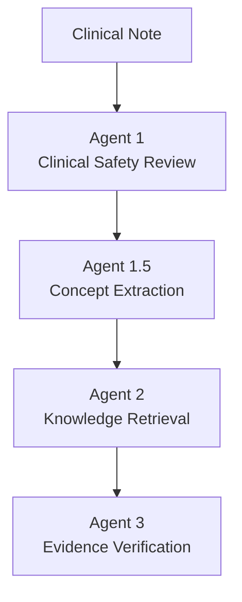

# 🛡️ ClinGuard-RAG

### A Clinical Decision Support and Safety Validation Framework for Reducing Diagnostic and Management Errors

> ⚠️ **Research prototype.** Not a medical device and not intended for clinical use. See the [Disclaimer](#-disclaimer).

---

## 📑 Table of Contents

- [Vision](#-vision)
- [Motivation](#-motivation)
- [Current Prototype Architecture](#-current-prototype-architecture)
- [Example Workflow](#-example-workflow)
- [Clinical Knowledge Base](#-clinical-knowledge-base)
- [Interesting Engineering Attempts](#-interesting-engineering-attempts)
- [Current Limitations](#-current-limitations)
- [Future Work](#-future-work)
- [Evaluation](#-evaluation)
- [Disclaimer](#-disclaimer)

---

## 🎯 Vision

Clinical reasoning is complex, especially in environments where clinicians are required to make rapid decisions under significant workload and time pressure.

Even highly trained clinicians can experience:

- Diagnostic uncertainty
- Cognitive fatigue
- Anchoring bias
- Missed drug interactions
- Delayed recognition of co-morbid conditions
- Incomplete consideration of alternative diagnoses

ClinGuard-RAG was developed as an experimental clinical decision-support framework designed to function as a **clinical second opinion system**, rather than a replacement for clinical judgment.

The long-term goal is to support clinicians by providing:

- Evidence-informed reasoning
- Retrieval of relevant medical knowledge
- Identification of potential safety concerns
- Highlighting of important diagnostic considerations

---

## 💡 Motivation

The project was inspired by a simple observation:

> **Better diagnosis often leads to better prognosis.**

Early recognition of disease, identification of contraindications, and retrieval of relevant evidence may reduce the likelihood of preventable adverse events and diagnostic delays.

ClinGuard-RAG explores whether **Retrieval-Augmented Generation (RAG)** and **multi-agent reasoning** can be used to support clinical decision-making workflows.

---

## 🏗️ Current Prototype Architecture

ClinGuard-RAG currently uses a multi-agent workflow.

### Agent 1: Clinical Safety Auditor

Reviews the clinical note and determines whether a potential clinical error may exist.

**Examples:**

- Medication errors
- Drug interactions
- Management inconsistencies
- Treatment errors
- Clinical safety concerns

### Agent 1.5: Clinical Concept Extractor

Extracts important clinical concepts such as:

- Diagnoses
- Symptoms
- Medications
- Clinical findings

**Example:**

```text
Clinical Note
      ↓
Type 2 Diabetes | Fatigue | Edema | Hypertension | Declining Renal Function
```

### Agent 2: Clinical Knowledge Retrieval Agent

Retrieves relevant evidence from a curated clinical knowledge base using:

- Sentence Transformers
- Semantic Embeddings
- FAISS Vector Search

The goal is to retrieve:

- Relevant diagnoses
- Drug interactions
- Associated conditions
- Management guidance

…rather than rely exclusively on the language model's internal knowledge.

### Agent 3: Clinical Evidence Reviewer

Reviews retrieved evidence and determines whether the evidence:

- Supports the clinical note
- Contradicts the clinical note
- Suggests additional considerations

---

## 🔄 Example Workflow



**Example:**

| Step | Output |
|------|--------|
| Input | `Lisinopril + Trimethoprim/Sulfamethoxazole` |
| Retrieval | `Drug Interaction: LISINOPRIL + TMP-SMX` |
| Risk | `Severe Hyperkalemia` |

Evidence is then used to support clinical review and reasoning.

---

## 📚 Clinical Knowledge Base

The current prototype contains manually curated clinical concepts including:

| Category | Concepts |
|----------|----------|
| **Chronic Disease** | Type 2 Diabetes Mellitus · Chronic Kidney Disease · Heart Failure · Hypertension |
| **Respiratory Conditions** | Community Acquired Pneumonia · COPD |
| **Infectious Diseases** | Sepsis · Pyelonephritis |
| **Trauma and Emergency Care** | Hemorrhagic Shock · Abdominal Trauma · Open Fracture |
| **Drug Interaction Knowledge** | Lisinopril + TMP-SMX · Warfarin + Antibiotics · NSAIDs + CKD · NSAIDs + Heart Failure |

---

## 🧪 Interesting Engineering Attempts

Several retrieval strategies were explored during development.

### Version 1: Keyword Matching

```text
Query → Keyword Search → Evidence
```

**Limitation:**

- Sensitive to wording
- Little semantic understanding

### Version 2: Semantic Retrieval

```text
Concepts → Embeddings → FAISS → Relevant Evidence
```

**Improvement:**

- Retrieved knowledge by meaning rather than exact wording

### Version 3: Concept-Level Knowledge Chunking

Instead of large domain documents:

```text
Respiratory Domain
```

knowledge was reorganized into:

```text
One Clinical Concept = One Retrieval Document
```

**Examples:**

- Community Acquired Pneumonia
- Lisinopril + TMP-SMX
- Heart Failure
- Chronic Kidney Disease

This significantly improved retrieval relevance.

---

## 🚧 Current Limitations

This repository is an **early research prototype** and is **not intended for clinical use**.

Current limitations include:

- Small curated knowledge base
- Limited disease coverage
- Small number of drug interactions
- No guideline integration
- No EHR integration
- Limited benchmark evaluation
- No hospital-specific adaptation

---

## 🔭 Future Work

Future development activities include:

### Knowledge Base Expansion

- Larger clinical concept library
- Broader disease coverage
- Expanded pharmacotherapy knowledge
- Diagnostic pathways
- Laboratory interpretation
- Clinical guidelines

### Clinical Reasoning Enhancement

- Differential diagnosis generation
- Suggested investigations
- Test recommendation support
- Missing diagnosis detection
- Contraindication detection

### Model Development

The long-term goal is to develop ClinGuard as a **reusable clinical intelligence framework**.

Rather than creating separate systems for individual hospitals:

```text
Hospital A    Hospital B    Hospital C
```

the objective is to develop a **transferable foundation framework** that can be adapted and refined using local clinical knowledge, practice patterns, and institutional data.

---

## 📊 Evaluation

Future work will focus on:

- Expanded benchmarking
- Clinical note evaluation
- Retrieval quality assessment
- Clinical usefulness studies
- Human-in-the-loop validation

---

## ⚕️ Disclaimer

> **ClinGuard-RAG is a research and educational project.**
>
> It is not a medical device, has not undergone clinical validation, and should not be used for diagnosis, treatment, or patient care decisions.
>
> Clinical judgment remains the responsibility of qualified healthcare professionals.
